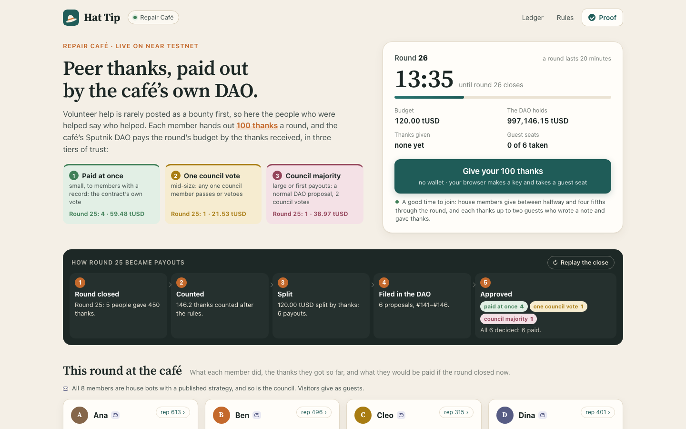
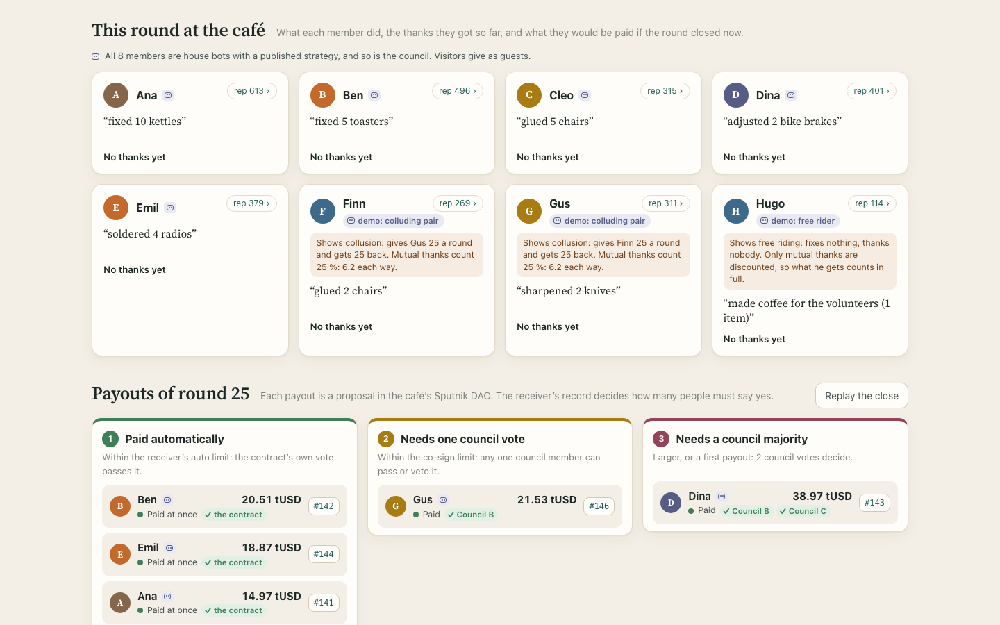
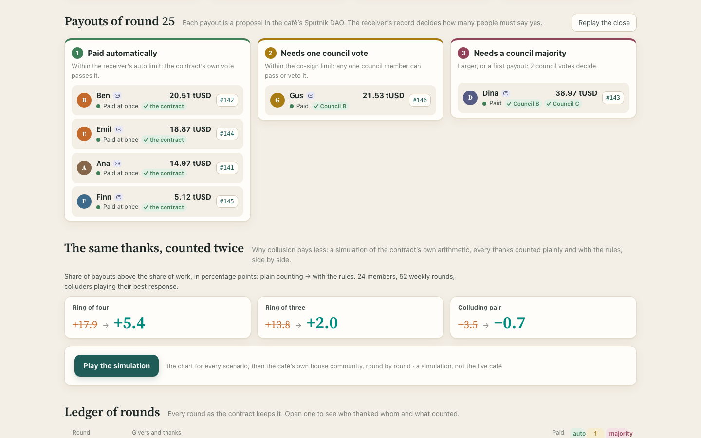
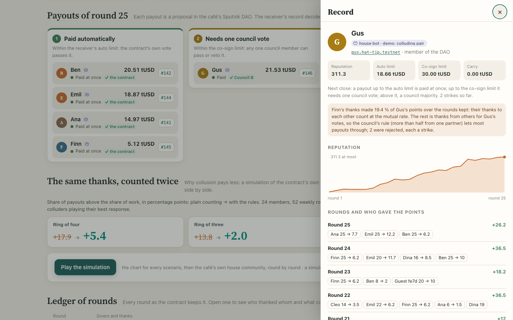
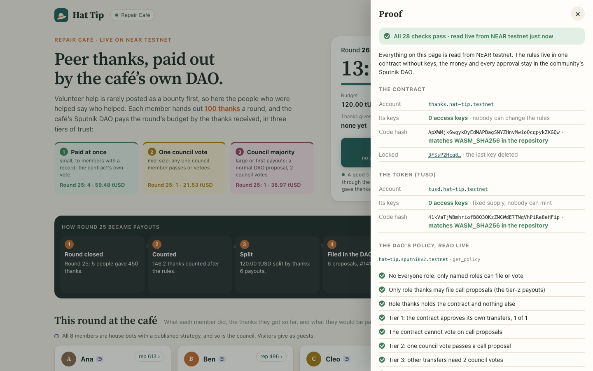

# Hat Tip: peer thanks that your DAO pays out

[](https://github.com/replaycourt/hat-tip/actions/workflows/ci.yml)



**▶ Try it now, no wallet: https://replaycourt.github.io/hat-tip/web/** · [Video, 90 s](https://x.com/replaycourt/status/2119435604131795220) · [JUDGE.md](JUDGE.md): a five-minute path and 14 read-only checks

**What.** Paying helpers from a DAO is slow by design: every payout is a proposal the council votes on. Hat Tip lets a community that keeps its money in a Sputnik DAO pay the people who helped, without a vote on every small payout and without a new multisig. Each member hands out 100 thanks a round; when the round closes, the DAO pays the round's budget by the thanks received. The receiver's record decides how many people must say yes: small payouts to members with a record pass at once by the contract's own vote, mid-size ones need one council member, large ones and most first payouts are a normal DAO proposal for the council majority.

**Why thanks instead of bounties.** The track's starter idea is a bounty board, and the hackathon guide says: *"Swap the starter idea for your own if you have a better one. Keep the requirements and the checkpoint."* Hat Tip swaps it. In a volunteer community most work is unplanned help that nobody posts or prices in advance: the kettle fixed in passing, the newcomer shown around. Thanks after the work capture it, and the people who were helped are the ones who judge it. The four requirements and the checkpoint stay, each met below in [Fits the track](#fits-the-track).

**Try it in a minute.** Open the page, tap *Give your 100 thanks* (your browser makes a key; there is no wallet prompt), tap *+10* on a few people and see every card's payout and tier move, then send. Join in the first half of a 20-minute round: the house members thank guests back between halfway and four fifths of the round. The dark strip under the title shows how the last round became payouts, in five steps; *Replay the close* plays it; every payout's number opens its proposal live from the DAO.

**Proof.** Everything runs on NEAR testnet in one contract with no access keys: `scripts/judge-checks.sh` reads 14 facts from the chain in about 15 seconds.

| You can check | How |
|---|---|
| Nobody can change a rule | `scripts/judge-checks.sh` checks 1-4 (0 access keys on the contract and the token, code hashes = `WASM_SHA256`) and 11 (`config()`) |
| The tiers are the DAO's own policy | checks 5-8: the three thresholds exactly, no `Everyone` role, only the contract may file `call` proposals, the factory cannot upgrade the DAO |
| Every payout is a real DAO proposal | check 12: the DAO's proposals against the contract's `payouts()`; the page links each payout to its proposal |
| The contract counts like the simulation | `contract/tests/golden.rs`: 6 vectors, 61 rounds, to the base unit; the page's `logic.js` passes the same vectors |
| It ran on the real chain | the final deployment: 24 rounds and 140 payouts in all three tiers by 2026-11-08 18:35 UTC; before it, a staging run of 28 rounds and 154 payouts with 6 council rejections ([docs/testnet-stage.md](docs/testnet-stage.md)) |
| What the rules do not stop | [Honest limits](#honest-limits): rings, one-way thanks, free riders, a guest farm, a colluding council |

| The round board | The payouts of the last round, by tier |
|---|---|
|  |  |
| **A member's record** | **The proof drawer** |
|  |  |

On a phone: [the round](docs/shots/final-phone-round.png), [the payouts](docs/shots/final-phone-payouts.png). All screenshots are of the live page on the final deployment.

## Fits the track

The `social` track: *"shared budgets, programmable rewards, collective ownership and reputation-based access on top of Sputnik DAO and Trezu."* Its starter idea, in brackets: *"Build [a bounty board with earned trust] for a community that already runs its treasury on Sputnik DAO or Trezu."* The hackathon's guide: *"Swap the starter idea for your own if you have a better one. Keep the requirements and the checkpoint."*

**The swap.** A bounty must be posted, priced and claimed before the work starts. In a volunteer community (a repair café, a meetup, an open-source project) most work is unplanned help that nobody posts or prices in advance. Hat Tip pays for it after the fact: the people who were helped say who helped, in a fixed budget of 100 thanks a round, and the DAO pays by the thanks received. Earned trust works as the prompt asks: a track record raises how much a person can be paid without a full council vote.

**The requirements and the checkpoint, kept:**

| The prompt requires | In Hat Tip | Where to check |
|---|---|---|
| 1. Use the existing DAO or Trezu treasury for custody and approvals; no new multisig | **Met.** Custody, membership, the council and every approval are a Sputnik v2 DAO from the public factory `sputnikv2.testnet`, unmodified (`version()` 2.3.1). The contract never holds the money: every payout is a DAO proposal the DAO executes, a `Transfer` (tiers 1, 3) or a `FunctionCall ft_transfer` (tier 2). | `scripts/judge-checks.sh` checks 5-8, 12, 14; `contract/src/dao.rs`, `contract/src/pay.rs`; [docs/testnet-probe.md](docs/testnet-probe.md) |
| 2. Reputation tied to named accounts; every point traceable to a finished bounty | **Met, with thanks in place of bounties:** every point traces to a round, its giver and the receiver's note of finished work ("fixed 2 kettles"). Members are named accounts in the DAO's `members` role (implicit and `0x` accounts are ignored). The `points` event and the `member()` view attribute every point; the page shows each giver as *given → counted* in the member's record and in the ledger. | `contract/tests/counting.rs` (`the_points_event_attributes_every_point`), `contract/tests/invariant.rs`; the `round(n)` and `member()` views |
| 3. Tiers: small payouts auto-approve for trusted contributors, mid-size need one council member, large become a normal DAO proposal | **Met, exactly**, in the DAO's own policy: role `thanks` (the contract) `transfer` 1 of 1, council `call` weight 1, default policy 1/2. The contract picks the tier from the receiver's reputation before the round; the auto and co-sign limits grow with it (0.06 tUSD per thanks, up to 30 tUSD), and a council rejection is a strike that takes reputation away. | `math::limits`, `math::tier`, `math::round_cap` in `contract/src/math.rs`; `contract/tests/dao.rs`, `contract/tests/reputation.rs`; check 5 |
| 4. A public board: open bounties, claims, payouts, each contributor's record | **Met as a round board.** In place of open bounties and claims: the running round, each member's note of what they did, the thanks so far and a live payout preview with its tier. Then the payouts by tier with DAO proposal links and votes, every member's record, and the ledger of every round. | the page, `web/` |
| Checkpoint: which approval flows already exist and which must be added | Answered below, from the Sputnik source and a probe on testnet. | [Which approval flows exist and which we add](#which-approval-flows-exist-and-which-we-add) |

**Where it differs, honestly.** Nothing is posted or claimed in advance, so a note is the receiver's own word, and the thanks of the people who were helped are what confirm it. Sputnik's own bounty flow (`AddBounty`, `bounty_claim`, `BountyDone`) could run next to Hat Tip in the same DAO for planned work; the demo DAO does not enable it. Trezu was not run: its hosted app is mainnet-only, and a Trezu treasury is a Sputnik DAO, so the contract binds to one the same way. Members are named accounts; near.social profiles are not used.

### Which approval flows exist and which we add

The prompt ends: *"tell me which approval flows already exist and which ones we need to add."* From the Sputnik v2 source (`near-daos/sputnik-dao-contract` at `5434a59`, `policy.rs`, `proposals.rs`) and a probe on testnet with hand-made transactions ([docs/testnet-probe.md](docs/testnet-probe.md)):

**Exist in Sputnik v2, used as they are:**
- Roles (`Group` of accounts, `Member`, `Everyone`) with permissions per proposal kind and action (`transfer:AddProposal`, `call:VoteApprove`, wildcards).
- Vote policies per role and per proposal kind, as a ratio of the role (`[1, 2]`) or a weight (`"1"`), and a default vote policy. A proposal passes as soon as one role whose permissions cover the vote reaches its threshold.
- Proposal kinds `Transfer` (NEAR or an NEP-141 token) and `FunctionCall`; a proposal bond, returned on approval, rejection and finalize-after-expiry and kept on removal; expiry after `proposal_period` and `Finalize`; `VoteRemove`; bounties; `FactoryInfoUpdate` (the factory's auto-update switch).

**How the three tiers map onto them** (no new DAO code):

| Tier | Flow |
|---|---|
| 1 | role `thanks` (the contract alone) may add and approve `transfer`, threshold 1 of 1: the contract files and approves in one transaction chain |
| 2 | only role `thanks` may add `call` proposals, and the council's vote policy for `call` is weight 1: one council member passes or vetoes what the contract filed, and nothing else |
| 3 | the contract files a `Transfer` and does not vote; the default policy needs a council majority |

The probe showed each of these on testnet before the contract was written: the role vote executes a transfer at once, a `call` proposal passes on exactly one council vote and on nothing less, the council cannot file a `call`, a tier-3 transfer needs two votes, bonds come back as stated.

**What Sputnik cannot do, and what Hat Tip adds:** Sputnik has no amount limits; the `thanks` role could approve a transfer of any size. The amounts behind the tiers are enforced by the contract's code alone, which is why the contract has no keys and its code hash is checked against this repository. Added outside the DAO: the rounds of thanks, the counting, reputation and strikes, the choice of tier per payout, `check_payout` recording each proposal's outcome, and the page. Turned off in the DAO: the factory's auto-update (`FactoryInfoUpdate`, check 8), so the factory owner cannot replace the DAO's code.

## How to use it

On the page (https://replaycourt.github.io/hat-tip/web/, or locally, see [Run it yourself](#run-it-yourself)):

1. **The top:** the idea in one line, the three tiers as tiles with the last round's numbers, and the round card: *Round N*, the countdown, the *Budget*, what *The DAO holds*, and *Give your 100 thanks* with a line on whether now is a good time to join.
2. **The dark strip, *How round N became payouts*:** *Round closed*, *Counted*, *Split*, *Filed in the DAO* (the proposal numbers filed so far), *Approved* (payouts per tier, how many are paid). It plays at every close; *Replay the close* plays it again.
3. **The board:** a card per member with this round's note, the thanks so far and the payout if the round closed now. All members are house bots with a published strategy; the demo roles say what they show (*Shows collusion: gives Gus 25 a round and gets 25 back. Mutual thanks count 25 %: 6.2 each way.*). Under it, the last round's payouts in three columns, each with its approvals as marks (*✓ the contract*, *✓ Council A*, *○ a council vote*) and its proposal number, which opens the proposal live from the DAO.
4. **Give:** *Give your 100 thanks* (no wallet prompt; the browser makes an ed25519 key and takes one of six guest seats), *+10* on the people whose work you value, a note, *Send my thanks*. Every card's preview and tier move as you go, and a line says why counted differs from given (*Thanked each other 25 with Gus: counted 6.2 each way.*). A guest's thanks count half; all guests together steer at most 20 % of a round. Each house member thanks up to two guests who wrote a note and gave thanks (5 each) when it gives, between halfway and four fifths of the round, so join early.
5. **After the close:** the round card shows your own result: who thanked you back, and a payout with its tier and proposal (a guest is never in tier 1), or a share below 5 tUSD kept for you and paid with a later round.
6. **Dig in:** *rep … ›* opens a member's record (reputation over the rounds, every round's points with their givers, given → counted, every payout with tier, proposal and status); *The same thanks, counted twice* opens with the simulation's result and plays it; *Rules* states `config()` and the DAO's `get_policy`; *Proof* opens with its verdict (*All N checks pass*) and lists keys, code hashes, policy checks, `audit()`, relay keys and your transactions.

## The mechanic

**A round** (20 minutes in the testnet demo, a week in the example for a real community). Every member of the DAO's `members` role gets 100 thanks: whole numbers, at most 25 to one person, at most 10 receivers, none to themselves; a new allocation replaces the old one, unspent thanks lapse. Anyone calls `close_round()` when the clock has passed the end (the page and the keeper do it).

**Counting** (integer arithmetic, every division rounds down; [contract/README.md](contract/README.md#counting-exactly)):

| Rule | Launch value | Hurts |
|---|---|---|
| Reciprocity: the mutual part of two members' thanks to each other counts at `reciprocal_bp` | 25 % | a pair that thanks each other |
| Breadth: a receiver backed by fewer than `breadth_k` givers counts at `breadth_bp` | fewer than 3 givers: 25 % | pairs, solo patrons |
| Guests: a guest's thanks weigh `guest_weight_bp`; all guests together steer at most `guest_cap_bp` and receive at most `guest_receive_cap_bp` of the round | 50 %, 20 %, 8 % | a farm of browser tabs |
| Quadratic aggregation, idle discount | off | (rejected by the simulation, below) |

**Paying.** The round's budget (120 tUSD on testnet, or less if the DAO holds less) is split by points. A share under 5 tUSD is carried for up to 12 rounds and paid with a later one; the rounding dust stays in the DAO. Reputation is the points over all rounds, decayed 7.5 % a round, minus strikes.

**The tiers, from the reputation before the round** (a burst of thanks cannot unlock itself):

| Tier | When | DAO proposal | Approved by |
|---|---|---|---|
| 1 auto | payout ≤ auto limit: 0.06 tUSD per thanks of reputation, from 200 thanks, at most 30 tUSD; never a guest | `Transfer` of tUSD | the contract's own `VoteApprove` (role `thanks`: `transfer` 1 of 1), in the filing transaction |
| 2 one council vote | payout ≤ co-sign limit: 14.4 tUSD + 0.06 per thanks, at most 30 tUSD | `FunctionCall` `ft_transfer` on tUSD | any one council member (council `call` threshold 1); one `VoteReject` vetoes it |
| 3 council majority | anything larger, most first payouts | `Transfer` of tUSD | the council majority (default policy 1/2: 2 of 3) |

At most 80 % of a round's budget may go out in tier 1; the largest tier-1 payouts move to tier 2 until it fits. A council rejection or removal is a **strike**: the receiver loses that round's points, decayed to today. An expired proposal is finalized so the DAO returns the bond, without a strike. Anyone can call `pay(max)` to file planned payouts and `check_payout(id)` to record a proposal's outcome.

The full rules are in [DESIGN.md](DESIGN.md), the API, the events and the gas in [contract/README.md](contract/README.md).

## Why NEAR

- **A contract with no keys inside a DAO role.** After deployment every access key of the contract and of tUSD was deleted (contract: tx `3FSsP2Hcq81rxjeAm1Won8tSdW6VYedk2j59vk23q7xv`, tUSD: `CLaqUhBJMMfWzeRoyCmmE42qGpSArK3inASpnn3LzDED`, 2026-11-08 10:20 UTC, [docs/testnet-launch.md](docs/testnet-launch.md)); nobody can redeploy them or change a parameter. The DAO's one lever is to remove the role, which pauses the contract (it reads the policy at every close and `sync()`; a failed filing pauses it too).
- **Cross-contract calls with callbacks.** A close reads the DAO's `get_policy` and the DAO's tUSD `ft_balance_of` in one joined promise and counts the round in the callback. Paying chains `storage_deposit` (registering the receiver with tUSD), `add_proposal` with the exact bond, and for tier 1 the contract's own `act_proposal(VoteApprove)`, after which the DAO runs the `ft_transfer` in the same chain.
- **Named accounts and implicit accounts.** Members and council are readable names (`ana.hat-tip.testnet`). A guest is the implicit account of a key its browser made; the contract registers it with tUSD before filing, so a visitor without a wallet can be paid.
- **Function-call keys.** Guests sign `hattip:v1:<contract>:<nonce>:<action>`; the page relays it through public function-call keys on a gas account that may only call `act`, `close_round`, `pay`, `check_payout` and `sync` on the contract. House members' keys may only call `allocate` and `note`, council keys only `act_proposal` on the DAO.
- **NEP-141 and NEP-297.** tUSD is an ordinary fungible token; the contract logs `hattip` events (`allocated`, `round_closed`, `points`, `payout_planned`, `filed`, `paid`, `rejected`, `struck`, ...) from which every reputation and payout status can be rebuilt (`contract/tests/invariant.rs`; on staging from all 744 transactions).
- **Cheap.** On testnet a whole payout, filed and decided, burns about 25 Tgas (0.0025 NEAR); a round of the house community about 0.017 NEAR; each payout leaves about 385 bytes (0.0038 NEAR) in the DAO's storage ([docs/testnet-stage.md](docs/testnet-stage.md#gas-measured)).

## Check it without an account

Plain curl against the public testnet RPC; python3 only decodes the view results, which the RPC returns as bytes. Run from the repository root. FastNEAR's free endpoint answers HTTP 429 to a quick burst of calls: `--fail --retry` waits and tries again without mixing an error page into the answer (or use `https://near-testnet.drpc.org`). `scripts/judge-checks.sh` does all of this and more in about 15 seconds.

```sh
C=thanks.hat-tip.testnet; T=tusd.hat-tip.testnet; D=hat-tip.sputnikv2.testnet
q() { curl -sf --retry 4 --retry-delay 2 https://test.rpc.fastnear.com -H 'Content-Type: application/json' -d "{\"jsonrpc\":\"2.0\",\"id\":1,\"method\":\"query\",\"params\":$1}"; }
v() { q "{\"request_type\":\"call_function\",\"finality\":\"final\",\"account_id\":\"$1\",\"method_name\":\"$2\",\"args_base64\":\"e30=\"}" | python3 -c 'import json,sys; print(json.dumps(json.loads(bytes(json.load(sys.stdin)["result"]["result"])), indent=1))'; }

# The contract and the token have no access keys. Expect "keys":[] twice
q "{\"request_type\":\"view_access_key_list\",\"finality\":\"final\",\"account_id\":\"$C\"}"; echo
q "{\"request_type\":\"view_access_key_list\",\"finality\":\"final\",\"account_id\":\"$T\"}"; echo

# The deployed code is the wasm whose sha256 this repository records. Expect two equal lines
q "{\"request_type\":\"view_account\",\"finality\":\"final\",\"account_id\":\"$C\"}" | python3 -c 'import json,sys,functools; s=json.load(sys.stdin)["result"]["code_hash"]; a="123456789ABCDEFGHJKLMNPQRSTUVWXYZabcdefghijkmnopqrstuvwxyz"; print(functools.reduce(lambda n,c: n*58+a.index(c), s, 0).to_bytes(32,"big").hex())'; cat contract/WASM_SHA256

# The three tiers in the DAO's own policy: role "thanks" transfer [1,1], council call "1", default [1,2]
v $D get_policy

# The factory cannot upgrade the DAO. Expect "auto_update": false
v $D get_factory_info

# The books add up. Expect "balanced": true and every other flag true
v $C audit

# Every parameter, fixed at init
v $C config
```

## Simulation

Before the parameters were fixed, [docs/SIMULATION.md](docs/SIMULATION.md) wrote down its decision rule, then ran it: 640 rule sets over communities with honest members of uneven contribution, free riders, a colluding pair, rings of three and four (each playing its best response), a newcomer and a guest farm. In short:

| | |
|---|---|
| Collusion rules picked | cap 25 per receiver, reciprocity at 25 %, breadth (fewer than 3 givers count 25 %); quadratic and idle off |
| Colluders' excess payout share (pair / ring of 3 / ring of 4) | +3.5 / +13.8 / +17.9 points without dampening, -0.7 / +2.0 / +5.4 with the launch rules |
| Honest members' payouts against their work | rank correlation 0.85 (0.83 without dampening) |
| An honest pair that really helps each other | loses 11 % of its payout (limit set in advance: 15 %) |
| Quadratic aggregation | cuts collusion most, but the honest pair loses 28-33 %: rejected by the rule |
| Testnet demo, steady state | 72 % of payouts in tier 1, 22-23 % in tier 2, 5 % in tier 3; a newcomer reaches tier 1 after 8 rounds |
| Guests' receive cap 8 % | a member feeding a guest farm moves a sixth of the budget instead of a quarter; honest visitors keep 85 % of their share |

`python3 sim/hat_tip_sim.py --check` (standard library only) recomputes the golden vectors, the replay and `sim/params.json` and fails on any difference; `python3 sim/hat_tip_sim.py` reruns everything, the sweep included (about 10 minutes on four cores). The contract (`contract/tests/golden.rs`) and the page (`web/test/golden.test.mjs`) close every round of the golden vectors exactly like the model, to the base unit and the milli-thanks.

## What is real and what is not

- **Testnet only.** The contract is `thanks.hat-tip.testnet`, the token `tusd.hat-tip.testnet`, the DAO `hat-tip.sputnikv2.testnet`, a Sputnik v2 DAO from the public factory (the staging deployment `thanks.hat-tip-stage.testnet` keeps its keys). Nothing runs on mainnet.
- **tUSD has no value.** A fixed-supply test token (1,000,000, all minted to the DAO at init, no mint method). Testnet NEAR pays gas and storage.
- **The community is a demo, run mostly by labelled bots.** The Repair Café's eight members (five honest helpers, the colluding pair finn and gus, the free rider hugo) and the three council members are house accounts played by `scripts/house.mjs` with strategies published in `sim/params.json` ("house") and on every card. The council votes by a published rule: tier 2 is approved unless more than half of the receiver's points came from one giver it thanked back with at least 6 thanks (a welcome of 5 to a guest does not count); tier 3 only with at least three givers behind it. They run in GitHub Actions ([.github/workflows/house.yml](.github/workflows/house.yml)), with keys only from a repository secret. At launch all three council seats are house accounts (`council-a`, `-b`, `-c`); no human holds one.
- **Visitors are real.** A guest's thanks, seat and payout are real transactions on testnet, relayed through public function-call keys (in `web/js/config.js`, public on purpose; anyone can spend their allowance, which pauses guest play until they are refilled).
- **Rounds move when someone calls.** The clock decides when a round ends; a call (the keeper, the page, anyone) closes it.
- **The evidence comes from scripts.** The staging run on testnet (2026-11-07, 28 five-minute rounds, 744 transactions, 154 payouts: 48 tier 1, 65 tier 2, 41 tier 3; 6 council rejections and one removal, each with its strike; `audit()` balanced after every round) was driven by the house script and three browser-style guests ([docs/testnet-stage.md](docs/testnet-stage.md)). The final deployment ([docs/testnet-launch.md](docs/testnet-launch.md)), read 2026-11-08 at 18:35 UTC after 24 rounds of 20 minutes: 140 payouts, 38 in tier 1, 63 in tier 2 and 39 in tier 3, two of them rejected by the council with their strikes (both gus's: round 2, tier 3, and round 17, tier 2), 2,733.84 tUSD paid, `audit()` balanced. Tier 1 began in round 9, once the first member's reputation passed 200 thanks (payout 40 to ana, DAO #41).

## Honest limits

- **Sputnik cannot limit amounts.** The tiers' amounts are enforced only by the contract's code: the `thanks` role could approve a transfer of any size. The DAO's protections are that the contract has no keys, its code hash matches this repository, and the council can remove the role with one majority proposal.
- **Free riders are not stopped.** The rules discount mutual thanks, not idleness (the simulation turned the idle discount down: it costs honest members who skip a round and is evaded by a token allocation). A member who thanks nobody keeps everything others give him: in the demo, hugo's vague notes ("made coffee for the volunteers (1 item)") earn him thanks from the honest house members, and in round 22 he received 41 counted thanks from four givers, the second-largest payout of the round, approved by the council's rule. Over the simulation he gets about 2.7 % of the payouts.
- **Collusion is dampened, not stopped.** A ring of four keeps +5.4 points of excess payout share in a 24-member community; colluders who thank one way only, alternating, pass reciprocity and the house council's rule. A ring as large as the community wins. Their first payouts land in tier 2 or 3, in front of the council, and a tier-1 payout cannot be stopped by the council (the auto limit and the 80 % round cap bound it).
- **Sybils are kept out only by DAO membership.** A DAO that admits fake members pays them; a council that colludes approves what it likes. That is the DAO's own trust assumption.
- **Popular people get thanked more than quiet ones.** Peer thanks measure how the community sees the work, not the work.
- **Guests are a demo device with caps.** One person with many tabs can take every guest seat (six a round), keep real visitors out and collect the house members' welcome thanks (about 7 % of the testnet budget, every payout behind a council vote). A member working with such a farm still moves about a sixth of the budget to himself and the farm.
- **Every payout stays in the DAO's storage.** Sputnik never deletes a proposal (except on removal): about 385 bytes, 0.0038 NEAR each. That is why small shares are carried, not paid.
- **The contract's copy of the member and council lists** is as fresh as the last close of a round with allocations or `sync()`.
- **The contract pays for its storage, the guests' too.** It starts with 11 NEAR (code, 108 rounds of logs with every guest seat taken, the bond float); with less than 1 NEAR free it refuses guests, and anyone can send it more ([contract/README.md](contract/README.md#storage)).
- **Trezu was not run** (its hosted app is mainnet-only). **No bounties:** the starter idea's bounty board is swapped for thanks after the work, with the requirements kept (see [Fits the track](#fits-the-track)).
- **AI-generated code.** An AI coding agent (Claude) wrote the code and documentation from a human's brief during the hackathon window. The evidence that it works: the contract's tests in a mock VM with a model of the Sputnik DAO, the golden test against the simulation, `audit()` balanced on chain, and the staging run with all three tiers. No human reviewed it line by line, and the contract has not been audited.

## Run it yourself

The page is static files with no build step and no dependencies. Serve the `web/` directory:

```sh
cd web && python3 -m http.server 8000 --bind 127.0.0.1
# live testnet:               http://127.0.0.1:8000/
# the staging deployment:     http://127.0.0.1:8000/?contract=stage
# made-up data, no chain:     http://127.0.0.1:8000/?mock=1
```

It needs Ed25519 in WebCrypto (Chrome 137+, Safari 17+, Firefox 130+) and has a strict Content-Security-Policy (connections only to the two testnet RPC hosts).

**Tests.**

```sh
node --test 'web/test/*.test.mjs'      # 93 tests: counting port vs the golden vectors, preview, giving, signing, policy checks, RPC, mock round, replay data, the close strip and the guest's result; about 7 s
node --test 'scripts/test/*.test.mjs'  # 12 tests: the house council's rule and the keeper's window; under 1 s
(cd contract && cargo test)           # 82 tests in the SDK's mock VM with a model of the Sputnik DAO; cold build about 11 minutes, tests about 2 s
(cd token && cargo test)              # 6 tests; cold build about 14 minutes
python3 sim/hat_tip_sim.py --check    # the simulation reproduces the golden vectors, the replay and the launch parameters; about 1.5 s
scripts/judge-checks.sh               # 14 read-only checks of the live deployment, about 15 s; --section staging for staging
```

Measured 2026-11-08 on a 4-core Intel Mac (macOS 15), cold builds from an empty target directory.

CI ([.github/workflows/ci.yml](.github/workflows/ci.yml)) runs the tests on every push and rebuilds both wasm files, comparing them with `WASM_SHA256` and with the code on chain, on Linux, an Intel Mac and an arm64 Mac; all six rebuilds are byte-identical to the deployed code. A watchdog ([.github/workflows/watch.yml](.github/workflows/watch.yml), `scripts/watch.py`) runs the read-only checks against the live deployment every hour and checks the gas, the NEAR the contract and the DAO have for storage, and that the house is running; a failure reaches the owner. Node 20 or newer, no install; Rust from `contract/rust-toolchain.toml` (1.95.0).

**Build.** `cd contract && ./build.sh --check` (and the same in `token/`) rebuilds the wasm with cargo-near 0.22 and compares its sha256 with `WASM_SHA256`; it fails if the wasm carries machine paths or exports a method beyond the expected list (no owner, admin, upgrade or withdraw method). `python3 scripts/compare-wasm.py contract/target/near/hat_tip.wasm --deployment contract` compares the result with the code on chain, section by section. Cold rebuilds on a 4-core Intel Mac (macOS 15, x86_64), which built the deployed wasm, take about 4.5 minutes per crate and are byte-identical to the chain.

**Your own community.** The scripts in `scripts/` (Node, no dependencies) create the accounts, the DAO with the tier policy (`create-dao.mjs`), deploy and lock the token and the contract (`deploy.mjs --lock` deletes every key after its checks pass), set up the relay keys and run the house. The staging deployment, step by step: [docs/testnet-stage.md](docs/testnet-stage.md#scripts). To bind the contract to an existing DAO, add a role `thanks` with the contract and the permissions above, and set the council's `call` vote policy to weight 1 (a policy proposal the council votes on).

## Hackathon note

Built at NEAR HACKATHON for the `social` track (Social Money). The same author also entered **Bonfire**, an independent project in the `memecoins` track: a memecoin you light together, on NEAR testnet, https://github.com/replaycourt/bonfire.

## Credits

Parts reused from Bonfire (same author): `contract/build.sh` and `token/build.sh` (privacy-safe build, host pin, export list, `WASM_SHA256`, the cargo-near variable fix), `scripts/compare-wasm.py`, `scripts/near-lite.mjs` (signing without dependencies), `scripts/setup-gas-pool.mjs`, the pattern of `scripts/judge-checks.sh`, `web/js/near.js` and the gas pool and RPC fallback in `web/js/chain.js`, the test layout, the CI rebuild job and the house workflow (Bonfire's `fire.yml`). The Sputnik v2 DAO is the public factory's code (`near-daos/sputnik-dao-contract`). Libraries: near-sdk and near-contract-standards in the contracts; their tests use the SDK's mock VM. The page and the scripts use nothing beyond the browser and Node's standard library; the simulation only Python's.

## License

MIT, see [LICENSE](LICENSE).
